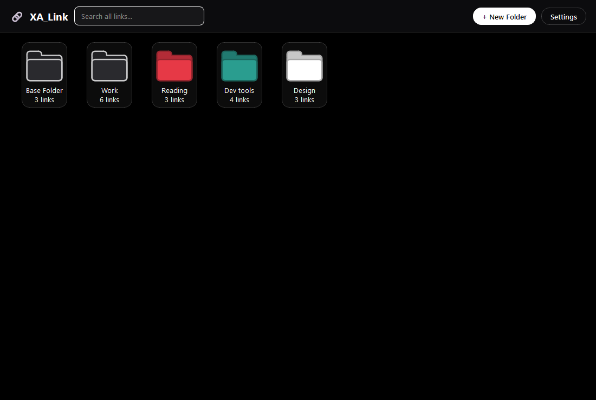
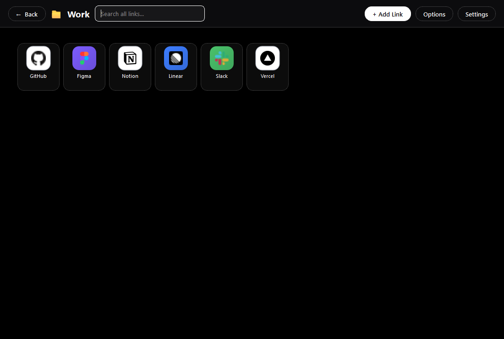
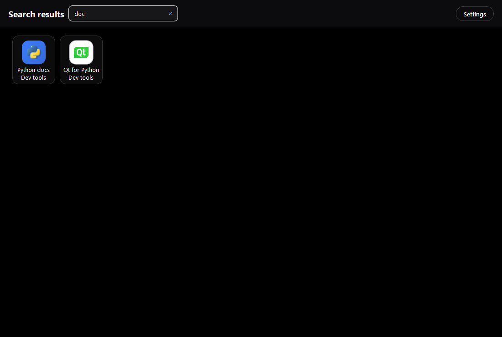
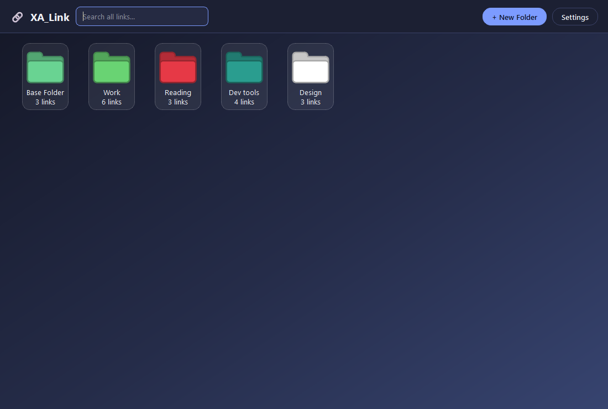
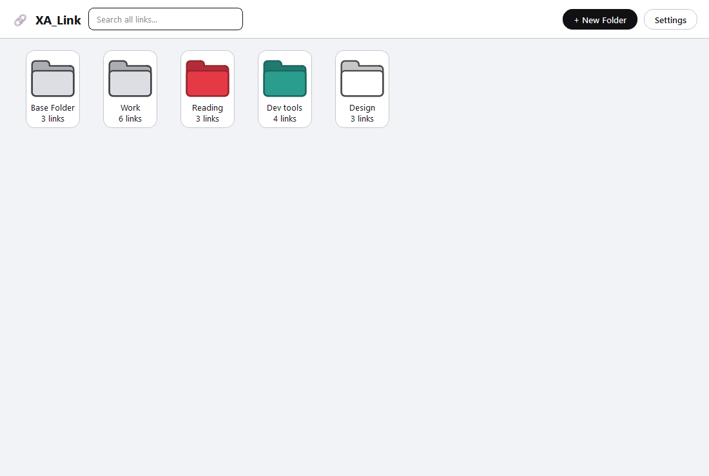
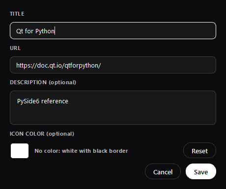
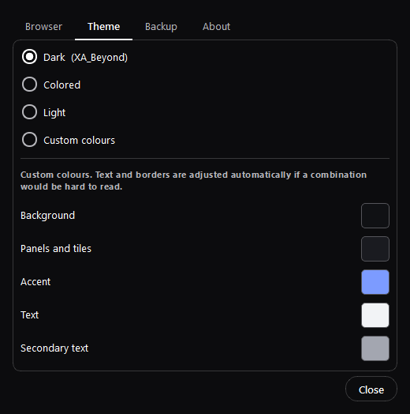

<p align="center">
  
</p>

<h1 align="center">XA_Link</h1>

<p align="center">
  <b>A desktop for your links.</b><br>
  Keep the sites you use every day on a desktop of your own,<br>
  sorted into folders you arrange yourself.
</p>

<p align="center">
  <a href="https://github.com/XA-Beyond/XA_Link/raw/main/XA_Link.exe"></a>
  <a href="https://xabeyond.net/xa-software.html#xa-link"></a>
</p>

<p align="center">
  Free &nbsp;·&nbsp; No account &nbsp;·&nbsp; No installer &nbsp;·&nbsp; Your links never leave your computer
</p>

<p align="center">
  
</p>

---

## Download

| Where | What you get |
| --- | --- |
| **[XA_Link.exe](https://github.com/XA-Beyond/XA_Link/raw/main/XA_Link.exe)** (this repository) | The program itself, ready to run |
| **[xabeyond.net](https://xabeyond.net/xa-software.html#xa-link)** | The same program in a ZIP, with a short guide inside |

**Requirements:** Windows 10 or Windows 11, 64-bit. Nothing else to install.

> [!NOTE]
> This repository is the official place to download XA_Link. The source code is not published.

## Getting started

1. Download `XA_Link.exe` and double-click it. There is no setup.
2. Click **+ New Folder** to make a folder, then double-click it to open it.
3. Click **+ Add Link**, type a title and an address, and save.
4. Double-click a tile to open the link in your browser.

You can keep the file anywhere: the Desktop, Documents, a USB stick. Moving it later does not lose your links.

## What it does

| | |
| --- | --- |
| **Folders** | One tile per folder on the desktop. Rename them, give them a colour, export them. Deleting a folder never deletes its links: they move to *Base Folder*. |
| **Link tiles** | Every link shows the site's real icon. Drag tiles wherever you like inside a folder: they snap to the nearest free spot and stay there. |
| **Search** | One search box looks through titles, descriptions and addresses in every folder at once. |
| **Link check** | A red **!** on a tile means the link did not answer the last time it was checked. |
| **Any browser** | Open links in your default browser, or pick a specific one. |
| **Themes** | Dark, Colored, Light, or five colours of your own. Text stays readable whatever you pick. |
| **Backup** | Export your whole library, or a single folder, to a JSON file. Importing adds to what you have and never overwrites it. |

## Screenshots

<table>
  <tr>
    <td width="50%"><br><sub><b>Inside a folder.</b> Real site icons, arranged your way.</sub></td>
    <td width="50%"><br><sub><b>Search everything.</b> Every folder at once.</sub></td>
  </tr>
  <tr>
    <td><br><sub><b>Colored theme.</b> A deep blue gradient with a matching accent.</sub></td>
    <td><br><sub><b>Light theme.</b> Every screen follows the theme you pick.</sub></td>
  </tr>
  <tr>
    <td><br><sub><b>Add a link.</b> A title, an address, an optional note and colour.</sub></td>
    <td><br><sub><b>Make it yours.</b> Dark, Colored, Light or custom colours.</sub></td>
  </tr>
</table>

## Tips

- **Right-click** a tile to open, edit, move it to another folder or delete it.
- **Right-click** a folder to rename it, change its colour, export it or delete it.
- **Click and hold** a tile to drag it.
- **Hover** a tile to see its full title, address and note.
- Starting XA_Link a second time brings the window you already have back to the front.

## Your data

Everything is stored on your own computer, as plain JSON you can read, copy or edit:

```text
%APPDATA%\XA_Link
├── links.json        your links and folders
├── settings.json     your browser and theme
└── favicon_cache\    site icons already downloaded
```

- To back up, copy that folder or use **Settings → Backup**.
- To uninstall, delete `XA_Link.exe`. Delete the folder above too if you want your links gone as well.

## Privacy

- No account, no sign-in, no telemetry, no ads.
- Your links are never uploaded anywhere.
- XA_Link only contacts the sites you saved yourself, to fetch their icon and check that the link still answers.
- If a site does not publish its own icon, its domain name is sent to Google's icon service to find one.

## "Windows protected your PC"

The first time you run XA_Link, Windows SmartScreen may warn you. That happens with every program that is not signed with a paid certificate, whatever the program does. Click **More info**, then **Run anyway**.

To check that your copy is exactly the one published here, run this in PowerShell in the folder with the file:

```powershell
Get-FileHash .\XA_Link.exe -Algorithm SHA256
```

It must print:

```text
B75BE3953C147FB2602E3D3922BC66EC3EB73ACB42C2D6BAF34A8AE6D6CB8E31
```

## Built with

XA_Link is built on the [Qt](https://www.qt.io/) framework, used under the GNU Lesser General Public License version 3. The full notices and licence texts are inside the program: open **Settings**, then **About**.

---

<p align="center">
  Made by <a href="https://xabeyond.net">XA-Beyond</a> &nbsp;·&nbsp;
  <a href="mailto:xabeyond.info@gmail.com">xabeyond.info@gmail.com</a> &nbsp;·&nbsp;
  <a href="https://www.instagram.com/xa_beyond/">Instagram</a> &nbsp;·&nbsp;
  <a href="https://x.com/XA_Beyond">X</a> &nbsp;·&nbsp;
  <a href="https://www.youtube.com/@XA-Beyond">YouTube</a>
</p>
